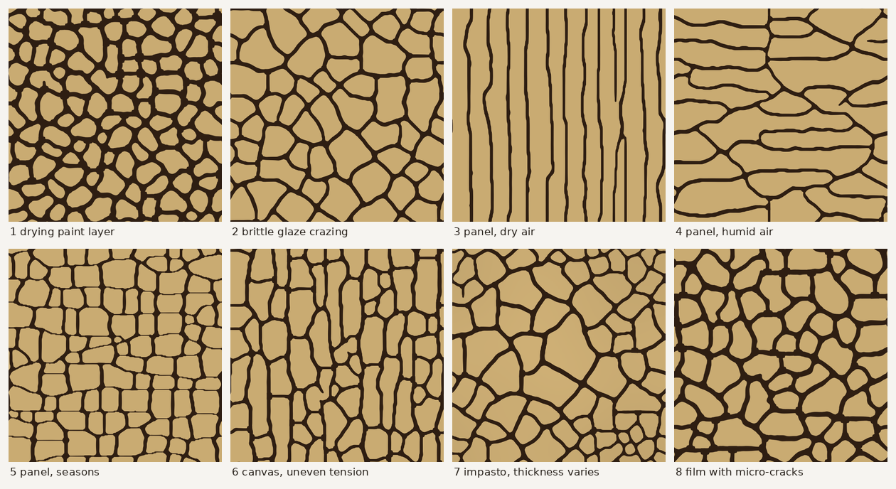

# craquelure

Crack networks in a shrinking brittle layer (paint, varnish, gesso, glaze, drying mud),
computed with fracture mechanics instead of drawn with a procedural pattern.

Written in Lua for LuaJIT, with a viewer for LÖVE 11.4+.
The solver module `craquelure.lua` has no LÖVE dependency.



## Why a paint layer cracks

A paint layer sticks to its support (canvas, wood, ceramic). Over time it wants to become
smaller than the support lets it: it loses solvent and water while drying, the binder ages,
the wood under a panel painting swells and shrinks with the humidity of the air. Because the
layer sticks, it cannot shrink, so it is stretched. The difference between the size the layer
wants and the size it is forced to keep is the *mismatch strain* `m`.

A crack frees the layer on both sides, but only over a short distance: the support holds the
layer through a thin zone of shear (the *shear lag*), so the tension builds up again within a
few layer thicknesses. Further away the layer is still stretched and can crack again. That is
why the crack spacing follows the layer thickness, and why old cracks stop new ones.

A crack needs two things:

* the stress must reach the strength of the material somewhere: this decides where cracks start;
* the elastic energy that a growing crack releases must pay for the new crack surface,
  `gc` per unit area (Griffith): this decides how far cracks run.

The model contains both. Nothing about the pattern is prescribed: no cells, no seed points.

## The model

Energy per unit film area, lengths in grid cells, Young modulus E = 1:

```
E(u, a) = int h * [ g(a) * psi_plus(e) + psi_minus(e) ]   film elastic energy
        + int k/2 * |u|^2                                 bond to the support (shear lag)
        + int h * gc * 3/8 * ( a/l + l * |grad a|^2 )     fracture energy

e    = sym(grad u) + m        elastic strain of the film, m = mismatch strain tensor
g(a) = (1 - a)^2              stiffness left in damaged material
k    = ebar / (le^2 * h)      stiffness of the bond, ebar = E/(1 - nu^2)
```

* `u` is the in-plane displacement of the film relative to the support. `a` is the damage
  field: 0 intact, 1 broken. A crack is a narrow band in which `a` reaches 1 (a *phase-field*
  or *smeared* crack). When the band width goes to zero this energy becomes exactly the
  Griffith energy of sharp cracks, so cracks can start, branch, curve and meet anywhere
  without any rule for where they go: the minimum of the energy decides.
* `le` is the shear-lag length: the distance over which the film gets its stress back next
  to a crack. With `le = Z * h` the model gives the exact energy release rate of a crack
  channelling through a film on a support, `G = Z * sigma^2 * h / ebar`, with `Z = 1.976`
  for equal film and support stiffness (Beuth 1992) and larger `Z` on a softer support.
  Crack spacing scales with `le`, so with the thickness.
* `l` (AT1 gradient damage model) is a material length. It sets the tensile strength
  `sigma_c = sqrt(3*gc*E/(8*l))`, so the model has both the strength criterion and the energy
  criterion. The ratio `le/l` says how brittle the layer is for its thickness: around 4 the
  layer reaches its strength before a crack can run, many cracks start together and grow
  toward each other; around 8 a crack that starts runs through the layer at once and the
  network forms crack after crack.
* `psi_plus / psi_minus`: the elastic energy is split into a tension part and a compression
  part (spectral split). Only the tension part is weakened by damage, so the layer never
  cracks under compression and a closed crack still carries compression.
* Open cracks: where the damage reaches `a_open` (0.9, less than 1 percent of the stiffness
  left) the layer is broken through. There is no film left there to be held by the support,
  so these points are set to `a = 1` and their bond is released. Without this the core of a
  crack band stays glued to the support, pulls on the crack faces and the band widens as the
  crack opens.
* Irreversibility: damage never heals. The mismatch changes in small steps and the energy
  is minimized at every step (quasi-static evolution).
* Heterogeneity: log-normal scatter of `gc` (correlated over `gc_corr` cells), optional
  thickness map, optional pre-existing micro-cracks.

### Load paths: drying, aging, humidity

The mismatch `m` is a tensor: it can be different along x and along y. It either grows along
a fixed direction (`s1, s2, angle` and a load range), or follows any *load path*, a list of
mismatch states. Damage is never undone, so the history matters.

On a wood panel the grain runs along x. Wood hardly changes its length along the grain but
swells and shrinks strongly across it, while the gesso ground shrinks about the same in all
directions. So:

* dry air: the gesso shrinks, the wood keeps its length along the grain and stretches it,
  across the grain the wood shrinks even more and compresses it. Cracks run across the grain
  (preset 3). Bucklow describes this direction for Italian panels.
* humid air: the wood swells across the grain and stretches the gesso across the grain.
  Cracks run along the grain (preset 4). The finite element studies of Jamalabadi et al. 2021
  and Antropov and Bratasz 2024 find exactly this: cracks along the grain come from swelling
  of the wood, cracks across it need shrinkage of the ground. Bucklow describes this direction
  for Flemish panels.
* seasons (preset 5): humid and dry periods alternate. Each season opens cracks in its own
  direction, closed cracks still carry compression, and together they cut the gesso into the
  rectangular islands typical for old panels.

### Crack width

Where a crack runs, the displacement jumps across the band. The size of this jump is the
crack opening. The craquelure view draws each crack with a line width that grows with its
opening (`,` and `.` change how strongly). A crack between two large islands opens wider than
a young crack that splits a small island, and a crack under compression closes to a hairline,
so the picture shows which cracks came first and which ones the present load opens. The
widths are exaggerated: real openings are a fraction of a percent of the island size.

## What comes out by itself

* Crack spacing follows the layer thickness. The islands of preset 2 end up 2.7 `le` across;
  with `le = 2 h` (layer and support equally stiff) that is about 5 layer thicknesses. 3D
  finite element studies of gesso on wood find crack spacings of 4.5 to 6 thicknesses.
* Order: the first cracks run long, later ones split the islands and stop at older cracks,
  mostly at right angles (T junctions).
* A layer that is weak for its thickness (`le/l` about 4) cracks in many places at once;
  the cracks curve and meet at wide angles.
* An anisotropic mismatch orients the cracks across the stronger tension; humidity seasons
  on a panel give rectangular islands.
* The viewer shows the number and mean size of the islands.

## Numerics

* Q1 (bilinear) finite elements on a periodic grid, so the result tiles seamlessly.
* Alternate minimization: `u` by a Newton step with a Jacobi preconditioned conjugate
  gradient solver and a line search, `a` by projected Gauss-Seidel with `a_prev <= a <= 1`
  and over-relaxation.
* While cracks run, only the region around the changing damage is solved again (the film
  answers within a few `le`); every load step ends with a check on the whole grid.
* The gradient, the tangent of the split energy and the damage derivative are verified
  against finite differences to 1e-9.

## Checks against analytic results

| check | model | analytic |
|---|---|---|
| stress recovery length next to a crack (le = 8) | 8.005 cells | 8 |
| opening of a straight crack (shear lag) | 2.80 | 2.66 (the band adds about one cell) |
| load at which a channel crack runs (le = 16, l = 2) | 0.73 p_ref | 0.72 p_ref (Griffith, `G = gc`) |
| fracture energy of a formed crack per unit length | 1.2 to 1.3 gc | gc (known grid effect of a band only 4 l wide) |
| width of a formed crack band under growing load | unchanged up to 2 p_ref (l = 2), 3 p_ref (l = 1.5) | unchanged |
| fracture energy versus crack angle to the grid (l = 1.5) | 1.27 to 1.38 gc | independent of angle |
| channel crack under equal biaxial tension, along an axis / a diagonal | 0.74 / 0.77 p_ref | equal |
| path of a crack driven 30 deg off a grid axis | runs at 27 to 28 deg | 30 deg |
| path of a crack driven 15 deg off a grid axis | turns onto the axis (0 to 5 deg) | 15 deg |
| same with toughness scatter 0.1 | 7 to 10 deg | 15 deg |

`p_ref` is the mismatch at which a flawless homogeneous film starts to damage. Beyond 2 to
3 `p_ref` a second crack forms next to a straight crack because the stress that recovers
within a few cells reaches the strength, which is physical. The last four rows are grid
effects, see the limits.

## Running

```
love .
```

Keys: `1`-`8` preset, `space` pause, `r` new random seed, `v` view
(craquelure / damage / stress / thickness), `t` 2x2 tiling, `+ -` grid size, `a` precise /
fast convergence, `, .` crack width per opening, `s` save view, `e` export large PNGs.

The viewer starts with a 192 x 192 grid: half a minute to 4 minutes per preset on one CPU
core, 256 x 256 takes 2 to 8 minutes. The picture updates while the cracks form. Exported
PNGs land in the LÖVE save folder (shown in the panel).

## Using the solver

```lua
local craq = require("craquelure")
local S = craq.new({ n = 256, ell = 2, le = 8, s1 = 1, s2 = 1, gc_std = 0.15 })
craq.run(S)                 -- or craq.load_step(S, p) for single steps
-- S.al[i] damage, S.ux[i], S.uy[i] displacement, i = y * n + x
-- craq.render(S, ptr, "craquelure", scale, width) writes (n*scale)^2 rgba8 pixels to ptr
```

A load path instead of a load range:

```lua
local S = craq.new({ n = 256, ell = 1.5, le = 12,
  path = { { 0.8, 0.8 }, { 0.7, 1.8 }, { 0.8, 0.8 }, { 1.7, 0.1 } }, load_step = 0.02 })
craq.run(S)
-- or step by hand: craq.mismatch_step(S, s1, s2, angle)
```

Set `S.yield_fn = coroutine.yield` and run `craq.run` inside a coroutine to spread the work
over frames (the viewer does this). `craq.opening(S)` fills `S.rw1` with the crack opening at
every node.

## Parameters

| key | meaning |
|---|---|
| `n` | grid nodes per side |
| `le` | shear-lag length, about 2 x film thickness on a stiff support |
| `ell` | AT1 length; `le/ell` large = brittle, long straight cracks |
| `s1, s2, angle` | principal mismatch and its direction; negative = compression |
| `load_start, load_end, load_step` | mismatch range in units of `p_ref` |
| `path` | list of mismatch states `{ along x, along y }` in units of the onset under equal shrinkage; replaces `s1, s2` and the load range |
| `gc_std, gc_corr` | toughness scatter and its correlation length |
| `h_std, h_corr` | thickness scatter and its correlation length |
| `kexp` | 1: film on a support (`le ~ h`), 0: soft interlayer (`le ~ sqrt(h)`) |
| `flaws, flaw_len` | number and length of pre-existing micro-cracks |
| `a_open` | damage at which a point counts as broken through |

## Limits of the model

* Grid effect. The crack band is only a few cells wide, so the square grid shows through: a
  crack must cut whole elements, and a crack along a grid axis can do that with one straight
  column of broken nodes, while a slanted one needs steps. A crack that should run within
  about 15 degrees of a grid axis therefore turns onto the axis; at 30 degrees it keeps its
  direction within 3 degrees. Toughness scatter (`gc_std = 0.1`) removes about half of the
  effect, and in whole networks the crack directions are then close to random (up to about
  1.4 times more segments near the axes in a 5 degree window). A wider band does not help
  much (`ell = 2` behaves like `ell = 1.5`). The real fix is a mesh without straight rows of
  nodes (random points, triangles).
* Thickness-averaged (2D) model: it has no fracture saturation. In 3D the stress at the
  surface of an island changes sign when the island is only about 2.5 to 6 thicknesses wide,
  depending on the stiffness of the layer, and cracking stops there (Jamalabadi et al. 2021);
  here islands keep splitting if the mismatch keeps growing, so the presets stop at moderate
  loads.
* No delamination: islands do not lift or cup (needs a second damage field on the bond and
  plate bending).
* No fatigue or creep: a crack only grows when a load state is more severe than all earlier
  ones in its direction; repeating the same humidity cycle does nothing.
* Constant material properties: gesso and young paint are softer and tougher in humid air.
* One layer: cracks through a ground and a paint layer with different properties are not
  resolved through the thickness.

## References

* J. L. Beuth, Cracking of thin bonded films in residual tension, Int. J. Solids Struct. 29 (1992)
* Z. C. Xia, J. W. Hutchinson, Crack patterns in thin films, J. Mech. Phys. Solids 48 (2000)
* A. A. Leon Baldelli, B. Bourdin, J.-J. Marigo, C. Maurini, A variational model for fracture
  and debonding of thin films under in-plane loadings, J. Mech. Phys. Solids 70 (2014)
* E. Tanne, T. Li, B. Bourdin, J.-J. Marigo, C. Maurini, Crack nucleation in variational
  phase-field models of brittle fracture, J. Mech. Phys. Solids 110 (2018)
* C. Miehe, M. Hofacker, F. Welschinger, A phase field model for rate-independent crack
  propagation, Comput. Methods Appl. Mech. Engrg. 199 (2010)
* S. Bucklow, The description of craquelure patterns, Studies in Conservation 42 (1997)
* L. Krzemien, M. Lukomski, L. Bratasz, R. Kozlowski, M. F. Mecklenburg, Mechanism of
  craquelure pattern formation on panel paintings, Studies in Conservation 61 (2016) 324-330
* Jamalabadi et al., Three-dimensional numerical and experimental study of fracture
  saturation in panel paintings, Wood Science and Technology (2021), doi 10.1007/s00226-021-01328-z
* S. Antropov, L. Bratasz, Development of craquelure patterns in paintings on panels,
  Heritage Science 12 (2024) 89, doi 10.1186/s40494-024-01189-2
